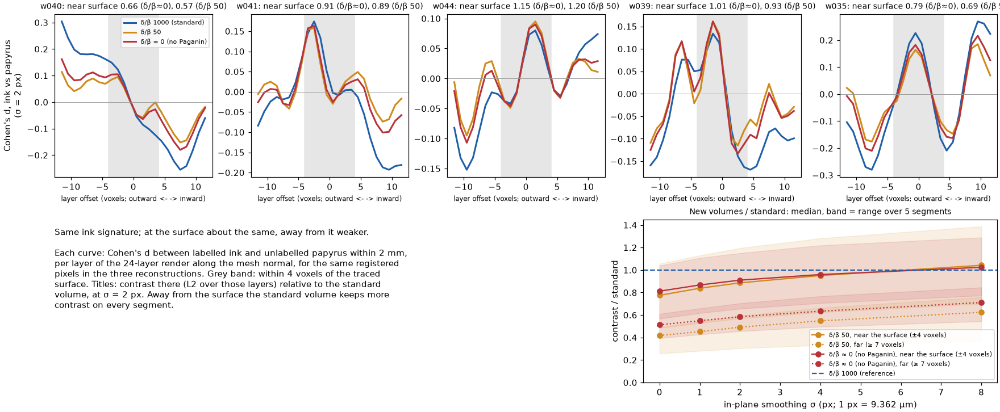
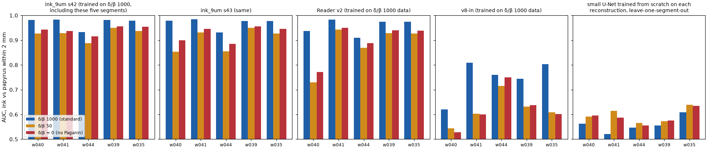
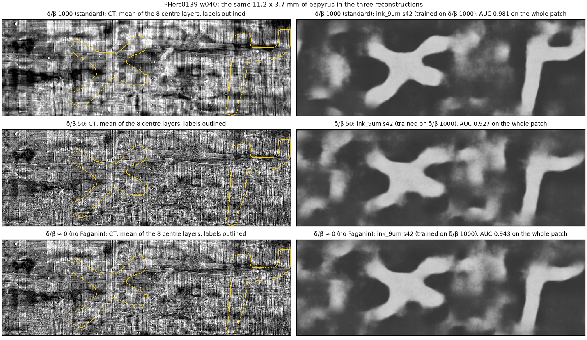

# pherc0139-paganin-ink-test

On 29 September the organisers published two more reconstructions of PHerc0139's 9.362 µm scan, the scan protocol
of the First Letters scrolls (BM18, 113 keV, 1.2 m): one with no Paganin phase retrieval (`pag0`) and one with a
weak one (`pag50`), next to the production volume (δ/β = 1000)
([#general, 29 Sep](https://discord.com/channels/1079907749569237093/1079907750265499772)). The BM18 paper shows
this comparison as a picture: a 2 × 2 mm slice at δ/β ≈ 0 and at 1000, where δ/β ≈ 0 is noisier with more
high-frequency texture, and 1000 has higher SNR and contrast but looks less sharp
([arXiv 2606.29085](https://arxiv.org/abs/2606.29085), Extended Data Fig. 2d). It does not measure ink.

This repository measures it. Five PHerc0139 segments have human ink labels on the 9.362 µm scan. The same labelled
patches are rendered from all three reconstructions, and ink is scored three ways:

1. **raw contrast, no model**: how different labelled ink is from the papyrus around it, layer by layer;
2. **a model trained on each reconstruction itself**, scored on a segment it did not see;
3. **the released ink models**, which were all trained on δ/β = 1000 data.

## Results

**At 9.362 µm, weaker phase retrieval is neither a clear win nor a clear loss for the ink itself.** At the traced
surface, where the ink is, the no-Paganin (δ/β ≈ 0) and low-Paganin (δ/β = 50) volumes show about the same ink
contrast as the production volume (δ/β = 1000). Away from the surface the production volume keeps clearly more
contrast. Every released model, all trained on δ/β = 1000 data, reads the new volumes worse. The one fair trained
comparison, a small model trained from scratch on each volume, does slightly better on the new ones, but it is
weak on all three: there is too little labelled 9.362 µm data to train a good one.

- **Same ink signature** (`results/fair.json`, figure 2). Cohen's d between labelled ink and the unlabelled papyrus
  within 2 mm of it, layer by layer through the 24-layer render, has the same depth profile in all three
  reconstructions. Shape correlation with the standard profile: 0.92-0.98 for δ/β ≈ 0, 0.82-0.95 for δ/β 50.
- **At the surface about the same, away from it weaker.** Contrast as a ratio to the standard volume (L2 of d over
  the layers; median over the five segments, range in brackets):

  | in-plane smoothing | δ/β ≈ 0, within 4 voxels of the surface | δ/β ≈ 0, 7 or more voxels away | δ/β 50, within 4 voxels | δ/β 50, 7 or more away |
  |---|---|---|---|---|
  | none | 0.81 (0.57-1.04) | 0.51 (0.39-0.61) | 0.78 (0.49-1.06) | 0.42 (0.26-0.49) |
  | σ = 2 px (19 µm) | 0.91 (0.66-1.15) | 0.59 (0.46-0.70) | 0.89 (0.57-1.20) | 0.49 (0.30-0.59) |
  | σ = 4 px (37 µm) | 0.96 (0.71-1.22) | 0.63 (0.50-0.77) | 0.95 (0.62-1.28) | 0.55 (0.33-0.66) |
  | σ = 8 px (75 µm) | 1.02 (0.77-1.29) | 0.71 (0.54-0.85) | 1.04 (0.70-1.39) | 0.62 (0.37-0.76) |

  Near the surface the new volumes match or beat the standard one on w044 and w039 and fall short on w040 and
  w035 (w041 is close). The extra noise of the weaker filters costs some contrast at fine scale and is
  recovered by smoothing. Far from the surface (65 µm and more, beyond the ~30 µm width of the Paganin filter
  here), the standard volume has more contrast on every segment at every scale: that is broader context, not the
  ink layer, and δ/β = 1000 renders it with a better signal-to-noise ratio.
- **Released models** (`results/models.json`, figure 3). AUC, mean over the five segments (lowest-highest):

  | model | δ/β 1000 (standard) | δ/β 50 | δ/β ≈ 0 |
  |---|---|---|---|
  | `ink_9um` seed 42 | 0.971 (0.932-0.983) | 0.926 (0.888-0.950) | 0.941 (0.916-0.956) |
  | `ink_9um` seed 43 | 0.970 (0.931-0.985) | 0.903 (0.853-0.950) | 0.926 (0.885-0.956) |
  | Reader v2 | 0.956 (0.910-0.983) | 0.879 (0.729-0.942) | 0.897 (0.771-0.950) |
  | v8-in | 0.747 (0.621-0.809) | 0.620 (0.544-0.716) | 0.624 (0.529-0.750) |

  Both new volumes score lower on every segment with every model (40 of 40 comparisons). `ink_9um` was trained on
  these very segments in the standard volume, so its numbers mostly show how much a model tuned to one
  reconstruction loses on another: 0.03-0.07 AUC for `ink_9um`, 0.06-0.08 for Reader v2, 0.12-0.13 for v8-in.
  Wrong layer order gives 0.43-0.56 on the standard volume, which confirms the order used.
- **A model trained on each reconstruction** (`results/fair_cnn.json`, figure 3). A small U-Net trained from
  scratch, leave-one-segment-out, three seeds: held-out AUC **0.559** on the standard volume, **0.597** on
  δ/β 50 and **0.590** on δ/β ≈ 0. The new volumes score higher on all five segments and in 13 of 15
  segment-seed pairs (+0.03 to +0.04), but every value is close to chance: four patches (14 cm²) are too little
  to learn 9 µm ink from scratch. This is a hint that the less-filtered volumes carry slightly more learnable ink
  texture, not a measurement of how much.

**What it means for the First Letters scans**, which use this protocol (about 9 µm, 1.2 m, 113-116 keV):
- Models trained on production volumes should not be run on low-Paganin reconstructions as they are: they lose
  0.03-0.13 AUC.
- Reprocessing with weaker Paganin does not make the ink layer stand out more to the eye or to a simple
  contrast measure; the context around it gets noisier.
- Whether a model *trained* on low-Paganin data would do better is open. The fair small-data test leans that
  way by a little. Answering it needs more labelled 9 µm data reconstructed both ways, which only the
  organisers can produce, since the raw projections are theirs.

The BM18 paper's other comparison, PHerc. Paris 4 at 2.4 µm and 0.22 m (Extended Data Fig. 3), shows the
no-Paganin slice "dominated by phase contrast fringes" and ink flakes standing out with δ/β = 1000. At 9 µm and
1.2 m, measured against labels, the picture is less one-sided.


*Figure 2. Top: each segment's ink-contrast depth profile in the three reconstructions (σ = 2 px); grey band =
within 4 voxels of the traced surface; titles give the new volumes' contrast there relative to the standard one.
Bottom right: those ratios near the surface (solid) and far from it (dotted) against smoothing.*


*Figure 3. AUC per segment for the released models (all trained on δ/β = 1000 data) and for a small model trained
from scratch on each reconstruction.*


*Figure 1. The same 11.2 x 3.7 mm of w040 in the three reconstructions: CT (mean of the 8 centre layers) with the
labels outlined, and the `ink_9um` map.*

## The three volumes

All three are the same acquisition (`SCROLLS_HEL_4.681um_113keV_1.2m_binmean_2_PHerc_0139`, 20 July 2025), as
listed in each volume's `metadata.json`:

| volume | id | Paganin δ/β | unsharp mask | detector distortion correction | uint8 export window |
|---|---|---|---|---|---|
| standard | `20250728140407-9.362um-1.2m-113keV-masked` | 1000 | 4.0 / 1.2 px | **on** | -0.03 .. 0.145 |
| pag50 | `20251107135911-9.362um-1.2m-113keV-pag50-masked` | 50 | 4.0 / 1.2 px | **off** | -0.16 .. 0.75 |
| pag0 | `20251107132835-9.362um-1.2m-113keV-pag0-masked` | 0.0001 | none | **off** | -0.09 .. 0.40 |

Two differences besides δ/β matter for anyone comparing them:

- **Detector distortion correction is off in both new volumes** (`DetectorDistortionCorrection: false`; the
  standard volume has it on, with a distortion map). So they are not a pure δ/β comparison.
- **They are not a shifted copy of the standard volume, so "aligned" depends on what is compared.**
  - Correlating 3-D boxes (`src/align_check.py`: high-passed, sub-voxel) at twelve points spread over the scroll
    gives offsets along z of **-0.79 to +0.70 voxels**, in-plane within 0.31 (`results/alignment.json`). The
    estimate is stable: at the five patch centres it moves by 0.03-0.16 voxel across boxes from
    32 × 96 × 96 to 128 × 512 × 512 (`results/alignment_box_sizes.json`).
  - Registering the traced sheet itself (the rendered surface, below) at five points gives z offsets of only
    **-0.28 to +0.02 voxels**, and at the same points the 3-D boxes disagree with it by up to 0.74 voxel
    (w039: +0.73 from the box, -0.01 on the sheet).
  - pag0 and pag50 agree with each other within 0.03 voxel at 11 of the 12 points (0.23 at the other): same raw
    data and processing.

  A pure translation would give the same answer both ways, so the reconstructions differ by more than a shift.
  The missing distortion correction is a plausible cause; this repository does not establish it. For anyone
  comparing the volumes pixel by pixel: register the things you compare (here, the rendered sheets), not the
  volumes, and check the residual. A 0.8-voxel error is 7 µm, invisible by eye but enough to bias a pixel-level
  comparison against labels.

## Method

- **Patches.** For each of w035, w039, w040, w041 and w044, the densest labelled 60 × 170-cell window of the
  published 9.362 µm mesh (11.2 × 31.9 mm, 3.5-3.6 cm² of surface each, 17.7 cm² in total; 1,200 × 3,400 px).
- **Alignment.** Each pag patch starts from the 3-D offset at the window's centre vertex. It is rendered, the
  render is registered to the standard render (middle layer, sub-pixel), the residual is turned into a 3-D offset
  with the mesh's local row and column directions, and the patch is re-rendered until the residual is under 0.1 px
  (every step in `results/renders.json`). Check in thirds of each window (`src/check_registration.py`,
  `results/registration.json`): every third of every patch matches the standard render within **0.18 px**. A first
  version that trusted the 3-D offset alone left two patches off by up to 0.9 px; all results here are from the
  registered renders.
- **Rendering.** 24 layers, -11.5 to +11.5 voxels along the smoothed mesh normal, at level 0, with the sampler
  validated against `vc_render_tifxyz` (`src/render_crop.py`, from
  [cross-scan-ink-transfer](https://github.com/TAUIL-Abd-Elilah/cross-scan-ink-transfer)).
- **Labels.** The published 9.362 µm labels (`ink-labels/9.362um-volume-20250728140407/20260918`) on the published
  mesh's canvas, unshifted (check: the `ink_9um` map of w040 matches them best at a (0, 0) shift, 1-px search).
  Scored pixels: labelled ink against unlabelled papyrus within 2 mm of it, at least 32 px inside the render.
- **Raw contrast** (`src/fair.py`). Cohen's d between ink and papyrus pixels, per layer, after in-plane Gaussian
  smoothing of 0, 1, 2, 4 and 8 px (smoothing trades the extra noise of the weaker filters against their
  sharpness). Per segment, each new volume's profile is compared with the standard one: shape correlation,
  least-squares scale, and the ratio of contrast (L2 of d) within 4 voxels of the surface and 7 or more voxels
  away.
- **Trained per reconstruction** (`src/fair_cnn.py`). A small 2-D U-Net (three levels, 32-128 channels) trained
  from scratch on four segments and scored on the fifth: 24-layer input z-scored per segment, 128 px crops (half
  centred on ink), flips, 1,500 steps of 16 crops, three seeds; identical for all three reconstructions.
- **Released models** (`src/models.py`). `ink_9um` seeds 42 and 43 (the organisers' release), Reader v2
  ([DomRusso2/reader-v2](https://github.com/DomRusso2/reader-v2)) and v8-in
  ([YoussefMoNader/ink-8um-v8in](https://huggingface.co/YoussefMoNader/ink-8um-v8in)), with their own
  preprocessing. **These are not a fair test between the reconstructions.** All were trained on δ/β = 1000 data,
  and `ink_9um` was trained on native 9.362 µm renders of exactly these five segments (its checkpoint config lists
  w035, w039, w040, w041, w044), so its scores here are on training data. They answer a narrower, practical
  question: does a model trained on the standard volume still read the other two?

## Limits

- Five segments of one scroll, one window each (17.7 cm² in total), and one scan protocol.
- There is too little labelled data here to train a fair ink model from scratch (see the U-Net result), so the
  fair comparison rests on the raw contrast; the released models are not neutral.
- Contrast "near the surface" uses the published mesh as the surface. Where the ink sits a few voxels off it,
  the near/far split is approximate; the full depth profiles are in `results/fair.json`.
- The two new volumes differ from the standard one in more than δ/β (distortion correction, export window).
  The measured difference is the difference between these published volumes, which is what a user of them gets.
- The labels were drawn on the 2.4 µm scan and carried to 9.362 µm. They sit 4.5-17.6 µm from where the texture
  places them ([pherc0139-scan-transform-check](https://github.com/TAUIL-Abd-Elilah/pherc0139-scan-transform-check)),
  under two pixels.

## Reproduce

```bash
source runs/env.sh
bash runs/01_align.sh      # results/alignment.json
bash runs/02_render.sh     # results/renders.json, $PAG_OUT/<segment>/{standard,pag50,pag0}.npy
bash runs/02b_check_registration.sh   # results/registration.json
bash runs/03_fair.sh       # results/fair.json
bash runs/04_models.sh     # results/models.json (needs a GPU, a villa checkout and the model weights)
bash runs/05_fair_cnn.sh   # results/fair_cnn.json (needs a GPU)
python src/figures.py      # figures/
```

Developed with AI assistance under my direction. MIT license.
